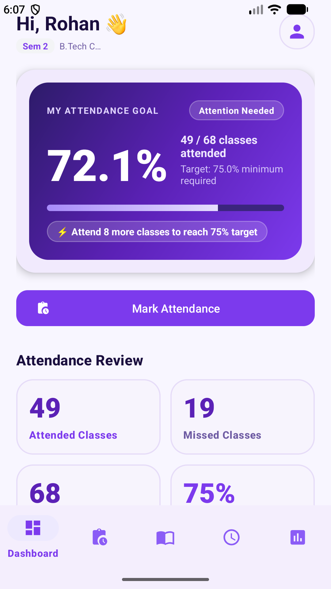
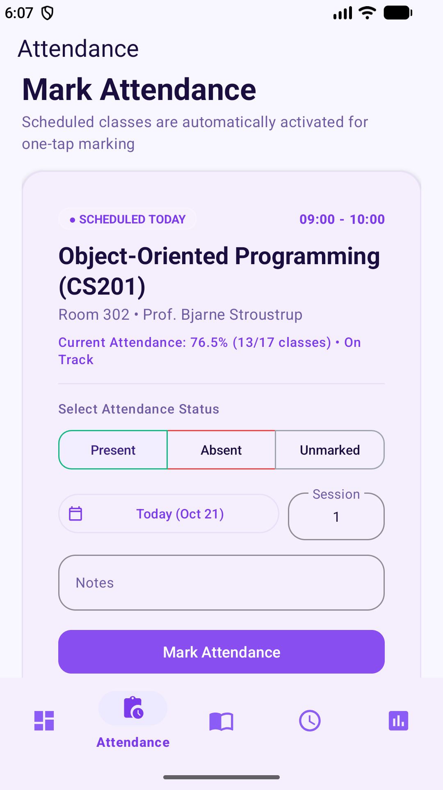
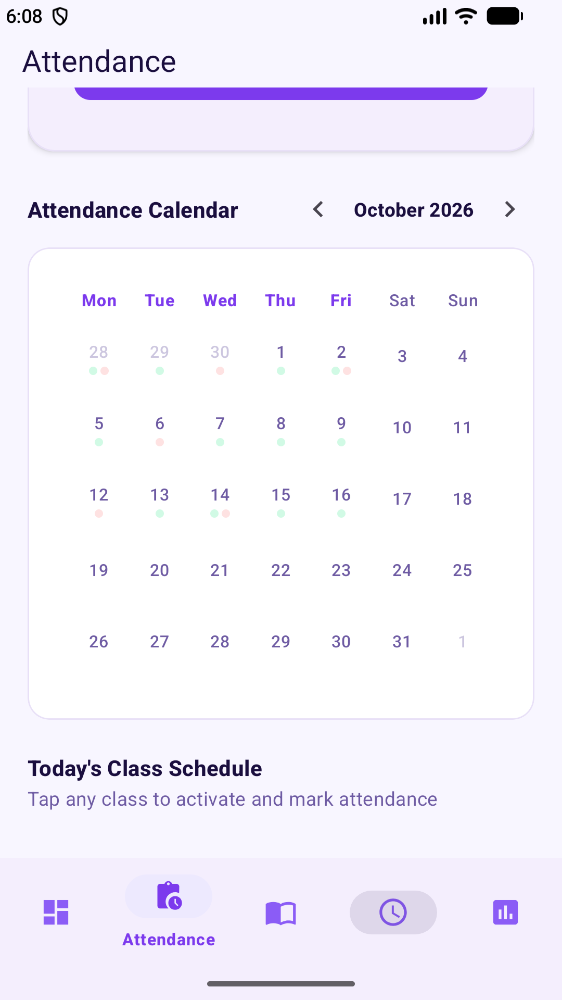
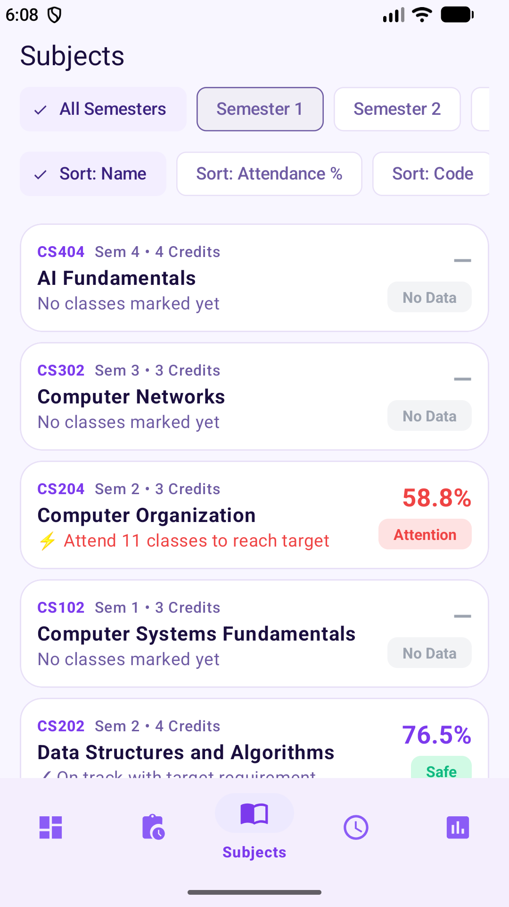

# 🎓 BlueStone — Student Attendance & Assignment Tracker

[](https://developer.android.com/)
[](https://developer.android.com/about/versions/15)
[](https://www.oracle.com/java/)
[](https://m3.material.io/)
[](https://developer.android.com/training/data-storage/room)
[](https://developer.android.com/topic/architecture)

**BlueStone** is a modern, offline-first Android application designed for university students to effortlessly monitor course attendance, visualize academic progress, manage class timetables, and maintain attendance above the required 75% target threshold.

---

## 📱 App Screenshots

<p align="center">
  
  
  
  
  
</p>

| Splash Screen | Student Dashboard | Mark Attendance | Attendance Calendar | Subjects Directory |
| :---: | :---: | :---: | :---: | :---: |
| Clean brand intro & launch | Overall % & Bunk Calculator | 1-Tap Attendance Marking | Monthly Overview & History | Course Directory & Credits |

---

## 🔑 Demo User Credentials

The app is pre-seeded with ready-to-test student accounts. You can type these credentials manually or tap any of the **Quick Demo Login Cards** directly on the sign-in screen:

| Student ID | Student Name | Degree & Program | Semester | Password |
| :--- | :--- | :--- | :---: | :--- |
| **`CS2026001`** | **Rohan Malhotra** *(Default)* | B.Tech Computer Science & Eng. | Sem 2 | `Blue@123` |
| **`CS2026002`** | **Aryan Sharma** | B.Tech Computer Science & Eng. | Sem 2 | `Blue@123` |
| **`CS2026003`** | **Ananya Patel** | B.Tech Computer Science & Eng. | Sem 2 | `Blue@123` |

> [!TIP]
> **One-Tap Demo Login:** On the login screen, simply tap any demo student badge (`Rohan Malhotra`, `Aryan Sharma`, or `Ananya Patel`) to automatically populate the credentials and log in instantly.

---

## ✨ Key Features

- **📊 Intelligent Attendance Dashboard:**
  - Real-time overall attendance percentage calculation against the 75% target.
  - Smart status indicators: dynamically alerts whether attendance is **Safe** (with number of safe bunks left) or requires **Attention** (with exact count of classes needed to get back on track).
  - Quick summary cards for attended, missed, and total conducted sessions.

- **⚡ Streamlined Attendance Marking:**
  - Smart class detection highlighting classes scheduled for the current day and time slot.
  - One-tap marking for **Present**, **Absent**, or **Unmarked** states.
  - Support for multi-session logging, date picker selection, and custom lecture notes.

- **📅 Interactive Attendance Calendar:**
  - Monthly calendar visualizer showing daily class attendance records with color-coded dot indicators.
  - Direct day selection to view schedule details and class statuses.

- **📚 Course & Subject Directory:**
  - Full semester course catalog with course codes, credits, and professor names.
  - Dynamic filtering by semester (All Semesters, Semester 1, Semester 2) and sorting (by Name, Attendance %, or Code).
  - Safe vs. Attention visual badges per course.

- **🔒 Robust Local Security & Privacy:**
  - Cryptographic password hashing using **PBKDF2 with HMAC-SHA256** and unique per-user salts.
  - Local authentication session persistence powered by **EncryptedSharedPreferences** backed by the Android Keystore.
  - Fully offline-first — all academic data remains private on the device inside Room SQLite database.

---

## 🛠️ Architecture & Tech Stack

- **Language:** Java 17
- **Target / Compile SDK:** Android 15 (API 35) / Minimum SDK: Android 8.0 (API 26)
- **Architecture:** MVVM (Model-View-ViewModel) + Repository Pattern
- **UI & Layout:**
  - Material Design 3 (M3) components, custom drawables, and themes
  - AndroidX ViewBinding for type-safe view access
  - Responsive layouts with `ConstraintLayout`, `MaterialCardView`, and `RecyclerView`
- **Navigation:** AndroidX Navigation Component with single-activity architecture
- **Data Persistence:**
  - AndroidX Room (SQLite ORM) with DAOs, Relations, and pre-seeded database callback
  - AndroidX Security Crypto (`EncryptedSharedPreferences`)
- **Optimization:** R8 / ProGuard enabled for release minification and resource shrinking

---

## 🚀 Getting Started

### Prerequisites

- [Android Studio Ladybug (2024.2+) or Meerkat](https://developer.android.com/studio)
- JDK 17 (configured in Android Studio under *Settings > Build, Execution, Deployment > Build Tools > Gradle > Gradle JDK*)
- Android SDK 35 (Android 15) and Build-Tools 35.0.0

### Build & Run

1. Clone or open the project folder in Android Studio:
   ```bash
   git clone https://github.com/rexmantode13/BlueStone.git
   cd BlueStone
   ```

2. Sync the project with Gradle files (`File > Sync Project with Gradle Files`).

3. Run the application:
   - Select an Android Virtual Device (AVD) running API 26 or higher (API 34/35 recommended).
   - Press **Run ▶** (Shift + F10) or assemble from command line:
     ```bash
     ./gradlew assembleDebug
     ```

4. Install the debug APK directly:
   ```bash
   ./gradlew installDebug
   ```

---

## 📂 Project Structure

```text
BlueStone/
├── app/
│   ├── src/main/
│   │   ├── java/com/bluestone/attendance/
│   │   │   ├── data/           # Room Database, DAOs, Entities & Repositories
│   │   │   ├── domain/model/   # Business models & summary aggregations
│   │   │   ├── ui/             # ViewModels, Fragments, Adapters & Views
│   │   │   │   ├── attendance/ # Class attendance marking & calendar
│   │   │   │   ├── dashboard/  # Main overview & attendance goal calculations
│   │   │   │   ├── login/      # Sign-in & demo profile selection
│   │   │   │   ├── reports/    # Academic analytics & CSV export
│   │   │   │   ├── subjects/   # Subject directory & assignments
│   │   │   │   └── timetable/  # Weekly schedule view
│   │   │   └── utils/          # PasswordHasher, CsvExporter, DateUtils
│   │   └── res/                # Layouts, navigation graph, themes, drawables
├── docs/
│   └── screenshots/            # App screenshots showcasing key screens
├── build.gradle
├── settings.gradle
└── README.md
```

---

## 📄 License

This project is licensed under the [MIT License](LICENSE) 
